# דוח פרומפט 6 - לאוקמי גירסא

**כרטיס התוס' בסמלילים עדינים, פאנל צד כברירת מחדל, וכפתור תוס' אחד מאוחד** · 26.10.2026

## בקצרה

א. בכל כרטיס תוס' ארבעת כפתורי הטקסט הוחלפו בארבעה סמלילים דקים: ספר פתוח, שני דפים, סמליל השיתוף של האתר ועיפרון. הם יושבים בשמאל הכרטיס, בסוף שורת הסיכום האחרונה, ויורדים לשורה משלהם רק כשהשורה מלאה. נמדד באתר החי: הכרטיס אינו גבוה מהסיכום ועוד שורה אחת, בכל ארבעת האופנים ובכל שלושת המכשירים.

ב. ריחוף על סמליל מציג כיתוב צף בעברית מיד (בהשהיה של 90 מילישניות, בלי הכיתוב האיטי של הדפדפן). בטלפון ובטאבלט הקשה מבצעת מיד, ולחיצה ארוכה מראה את הכיתוב בלי לבצע. בפעם הראשונה בכל מכשיר מגע מופיע מתחת לסמלילים מקרא קטן לשנייה וחצי, ואחר כך הוא נעלם.

ג. "העתק" אינו מציג עוד הודעה: הסמליל הופך לסימן ✓ לשנייה וחוזר. גם "נעץ" ו"סגור" בכרטיס הריחוף הם עכשיו סמלילים (נעץ ו־X).

ד. לחיצה על "תוס'" פותחת פאנל צד, ובטלפון מגירה תחתונה. מי שנתקע בעבר בהערות שוליים חוזר לפאנל פעם אחת בכל מכשיר. מכאן והלאה האופן שהוא בוחר בתפריט נשמר. בטאבלט בטור אחד, שבו אין מקום לפאנל, מוצגת רשימה במקומו באופן אוטומטי.

ה. כפתור "אופן" בוטל. כפתור "תוס'" הוא עכשיו כפתור אחד: עיקר הכפתור מדליק ומכבה, וחץ קטן ▾ בתוך אותה מסגרת פותח את תפריט האופנים. בטלפון התפריט נפתח בלחיצה ארוכה על "תוס'" בסרגל התחתון. כשהתוס' דלוקים, הכפתור מואר בזהב ומראה סמליל זעיר של האופן הנוכחי.

ו. בתפריט שלוש אפשרויות עיקריות, כל אחת עם סמליל ושורת הסבר: פאנל צד (מומלץ), רשימה והערות שוליים. מתחת לקו מופיעים "סימנים בלבד" ו"כבוי". האפשרויות למנהל (בדיקת תוספות ומבחן מנועים) נשארו בתחתית, אחרי קו נוסף.

ז. **הכרעה על "בצד":** האופן הזה נשאר, בשם "סימנים בלבד", בתחתית התפריט. בפועל הוא שונה מהאחרים: אין בו פאנל, אין רשימה ואין הערות בתחתית העמוד, אלא רק סימן קטן בטקסט שלחיצה עליו פותחת כרטיס. השם "בשולי השורה" לא נבחר, כי בשולי השורה אין שום דבר.

ח. בראש פאנל הצד, ובראש הרשימה, הוחלף הבורר הנפתח בשורת אותם סמלילים, עם כיתוב צף, ומסונכרנת עם התפריט. כך יש רק "שפה אחת" לבחירת אופן.

## לפני ואחרי

**הכפתור בסרגל העליון** (לפני: "דלוק"; אחרי: כפתור אחד מואר, עם סמליל האופן וחץ)

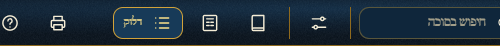

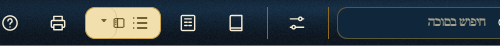

**קידושין יד:, מחשב, פאנל צד**

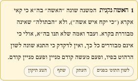

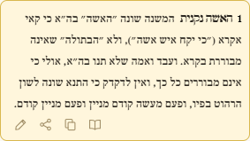

**סוכה ב:, טלפון, מגירה תחתונה**

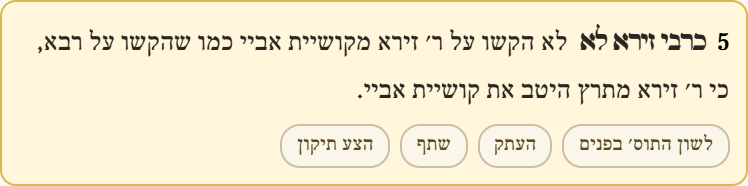

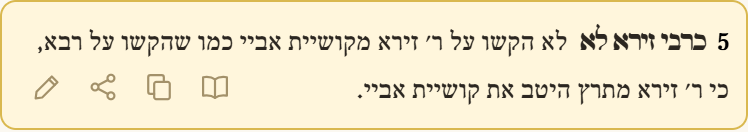

**קידושין יד:, טאבלט, רשימה**

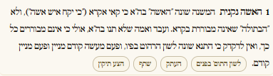

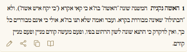

**סוכה ב., מחשב, הערות שוליים**

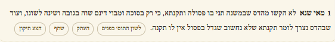

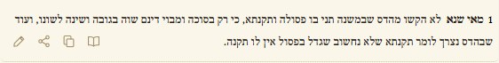

**קידושין, טלפון, כרטיס צף (סימנים בלבד)**

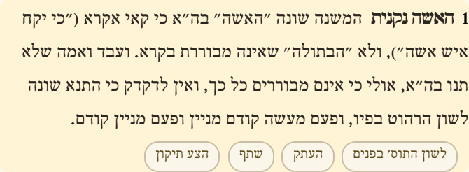

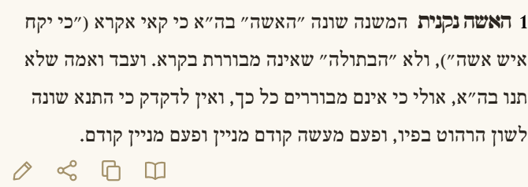

**תפריט האופנים (החץ שבכפתור)**

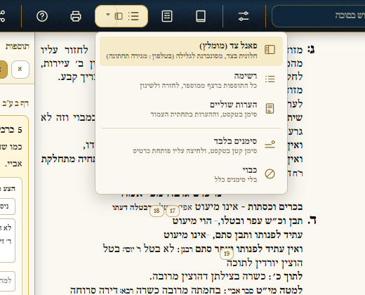

**כיתוב צף, ו"העתק" שהפך ל־✓**

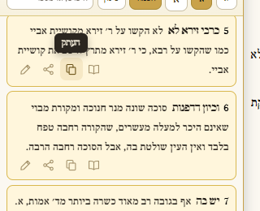

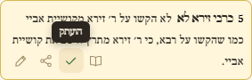

**טלפון: המקרא בפעם הראשונה, ולחיצה ארוכה על "תוס'"**

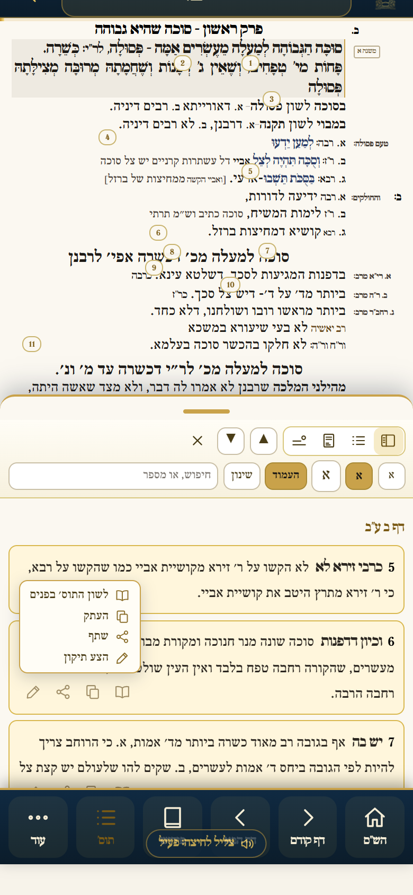

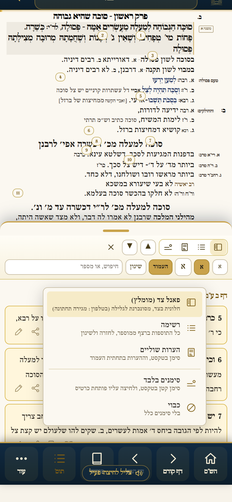

## מה נבדק באתר החי (אחרי הפרסום)

א. 24 צילומי כרטיס: סוכה ב. וקידושין יד:, ארבעה אופנים, במחשב (1400), בטאבלט (768) ובטלפון (390). ב־22 מהם הצילום הצליח בהרצה האוטומטית. בשניים שנכשלו (טאבלט, קידושין) הרשימה נפתחה לאט ממשך ההמתנה של כלי הצילום; בבדיקה חוזרת נמצאה הרשימה פתוחה, עם 637 כרטיסים.

ב. 29 בדיקות תפקוד בדפדפן אמיתי, וכולן עברו:
- לשון התוס' בפנים נפתח ונסגר.
- "העתק" מעתיק את הנוסח ומראה ✓.
- "שתף" פותח את חלון השיתוף.
- "הצע תיקון" פותח את החלון הקיים גם לאורח.
- הכיתוב הצף מופיע בעברית.
- התפריט ושורת הסמלילים מחליפים אופן.
- תצוגת ספר וחלון ההדפסה לא הושפעו.
- בטלפון: לחיצה ארוכה פותחת את התפריט, ובסמליל מראה כיתוב ואינה מבצעת.

ג. דפדפן נקי: הלחיצה הראשונה על "תוס'" פותחת פאנל צד. גם בדפדפן שהיו שמורים בו "הערות שוליים" ישנות הלחיצה הראשונה פותחת פאנל צד, ובחירה מפורשת אחרי זה נשמרת.

ד. דפדפן שכבר ביקר באתר לפני הפרסום, עם זיכרון המטמון שלו, קיבל את העדכון כבר בטעינה הראשונה.

ה. לא נמצא עוד כפתור "אופן" בשום מקום. גוף הגמרא לא שונה.

ו. **דבר שאינו מן המנה הזאת:** סוכן סריקת התצוגה בבנייה האוטומטית נופל כבר מהפרסום הקודם (שגיאת "BOOK is not defined"). לכן חסר באתר הקובץ שלוח הבקרה קורא, ובקונסול מופיעה שגיאת 404 אחת. השגיאה אינה נראית ללומד.

## פרסום

רק העדכון הזה נדחף ל־main ופורסם בבנייה האוטומטית. שני קבצים השתנו: קוד התוס' ושורת הכפתור בבניית הדף.
